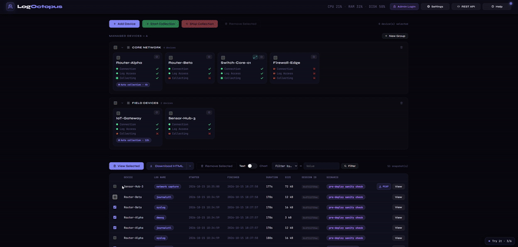
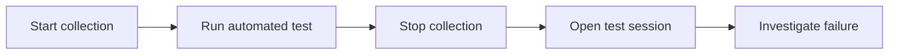
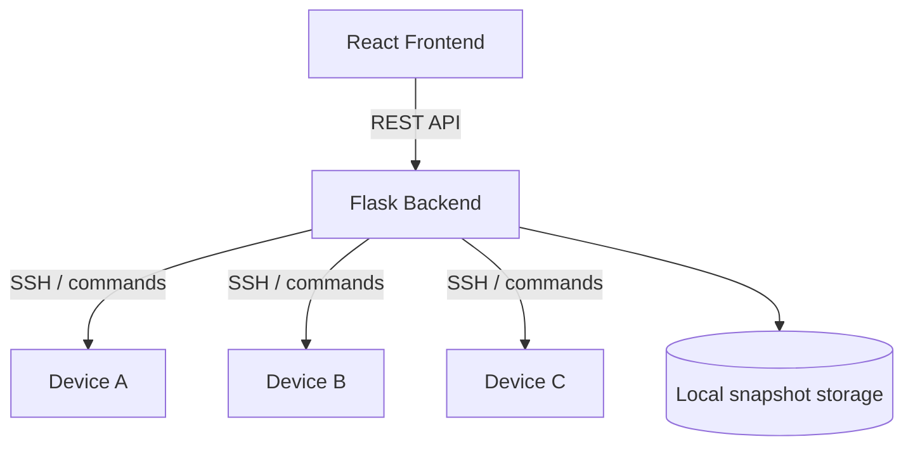

<div align="center">


# LogOctopus

### One test. Multiple devices. One place to debug.

Collect logs, metrics, command outputs and packet captures from every device
in a test, and investigate them together in a single **test session**.

<br>

<a href="https://kkuuba.github.io/LogOctopus/">
  
</a>

<br><br>

[](https://github.com/kkuuba/LogOctopus/actions/workflows/ci.yml)
[](LICENSE)
[](https://github.com/kkuuba/LogOctopus/stargazers)
[](#-quick-start)
[](#-features)

[**Live demo**](https://kkuuba.github.io/LogOctopus/) ·
[**Quick start**](#-quick-start) ·
[**Features**](#-features) ·
[**REST API**](#-rest-api) ·
[**Contributing**](#-contributing)

<br>

<a href="https://kkuuba.github.io/LogOctopus/">
  
</a>

<sub>👆 Click the preview to open the interactive demo.</sub>

</div>

---

## 🎯 Why LogOctopus?

When a multi-device test fails, the evidence is scattered across machines. LogOctopus is built around **test sessions**, not generic log aggregation, and answers one question:

> **What happened during this test?**

<table>
<tr>
<td width="50%" valign="top">

### ❌ Without LogOctopus

```text
Test failed
   ↓
SSH into device A → find logs
   ↓
SSH into device B → find logs
   ↓
Check system state
   ↓
Compare timestamps by hand
   ↓
Open Wireshark
   ↓
Reconstruct what happened
```

</td>
<td width="50%" valign="top">

### ✅ With LogOctopus

```text
Test failed
   ↓
Open the test session
   ↓
All evidence, one timeline:
  • application logs
  • system logs & metrics
  • command output
  • packet capture
   ↓
Investigate the failure
```

</td>
</tr>
</table>

### See the failure in one timeline

```text
14:31:07.120  Client     request started
14:31:07.124  Router     packet forwarded
14:31:07.131  Server     request received
14:31:07.145  Embedded   application error   ← root cause
14:31:10.145  Client     timeout
```

No more correlating timestamps across four terminals.

---

## ✨ Features

| | |
|---|---|
| 🔌 **Multi-device collection** | Collect from many SSH-accessible devices at once: direct connections, gateway / jump hosts, custom commands, log files. **No agent required.** |
| 🧪 **Test-session investigation** | Every run is a session with scenario name, timestamps, device info, logs, metrics, command outputs and captures. |
| 📋 **Unified log explorer** | Merged timeline, filtering, highlighting, CSV export, interactive charts with zoom & pan, device comparison. |
| 📡 **Packet capture** | Collect `pcap` data and inspect decoded packets next to your logs. Ideal for timeouts, packet loss and protocol issues. |
| 🤖 **Automation friendly** | Start/stop collection from CI/CD, Python test suites or any runner via REST API. |
| 🗄️ **Zero-dependency storage** | Local snapshot storage. No external database for the basic setup. |

**Works with:** Linux · Windows · Raspberry Pi · Cisco · MikroTik · pfSense · Proxmox · Synology NAS · embedded devices · custom test infrastructure

---

## 🚀 Quick start

**Requirements:** Docker, Docker Compose, and SSH access to the devices you want to collect from.

```bash
# 1. Clone
git clone https://github.com/kkuuba/LogOctopus.git
cd LogOctopus

# 2. Configure (see docs/example_configs/ for ready-made device configs)
nano .env

# 3. Run
docker compose up -d
```

| Service  | URL                     |
| -------- | ----------------------- |
| Frontend | <http://localhost:8100> |
| Backend  | <http://localhost:8050> |

> 💡 Not ready to install? **[Explore the live demo →](https://kkuuba.github.io/LogOctopus/)**

<details>
<summary><b>⚙️ Device configuration example</b></summary>

<br>

Devices are configured in JSON:

```json
{
  "device_name": "Linux Server",
  "ip_address": "192.168.1.10",
  "port": 22,
  "user": "test-user",
  "log_file_configs": [
    {
      "log_name": "system_log",
      "log_file_cmd": "journalctl",
      "log_type": "text"
    }
  ]
}
```

More examples (Linux, Windows, Cisco, MikroTik, pfSense, Proxmox, Raspberry Pi, Synology NAS) live in [`docs/example_configs/`](docs/example_configs/).

</details>

---

## 🤖 REST API

Integrate collection into automated tests in three steps:



```bash
curl -X POST http://localhost:8050/api/start-logs-collection \
  -H "Content-Type: application/json" \
  -d '{
    "selected_devices": ["server-01"],
    "session_scenario": "test"
  }'
```

The API lets you start/stop collection, manage devices, query snapshots and retrieve logs. It plugs into **CI/CD pipelines, Python test suites, custom runners and automation frameworks**.

---

## 🏗️ Architecture



**Stack:** React · Flask · SSH-based collection layer · local snapshot storage

<details>
<summary><b>📁 Project structure</b></summary>

```text
LogOctopus/
├── backend/             # Flask backend
├── frontend/            # React frontend
├── demo/                # Demo environment
├── docs/                # Documentation and examples
├── tests/               # Tests
├── Dockerfile.backend
├── Dockerfile.frontend
├── docker-compose.yml
└── README.md
```

</details>

---

## 🆚 How it compares

|                             | **LogOctopus** | Manual SSH | Generic log platform |
| --------------------------- | :------------: | :--------: | :------------------: |
| Multi-device collection     |       ✅       |     ⚠️     |          ✅          |
| SSH-based collection        |       ✅       |     ✅     |       Usually        |
| No agent required           |       ✅       |     ✅     |       Usually        |
| Test-session grouping       |       ✅       |     ❌     |          ⚠️          |
| Test-oriented investigation |       ✅       |     ❌     |          ⚠️          |
| Network captures            |       ✅       |   Manual   |       Depends        |
| Quick local setup           |       ✅       |     ✅     |       Usually        |
| CI/CD integration           |       ✅       |     ⚠️     |          ✅          |

> LogOctopus is **not** a replacement for general-purpose observability platforms. It solves a different problem: *collecting and investigating evidence from distributed test executions.*

---

## 👥 Who is it for?

| Role | How LogOctopus helps |
| --- | --- |
| 🔧 **Embedded engineers** | Application and system logs from embedded Linux devices during automated tests |
| 🧪 **QA / test automation** | Evidence for failed integration and system tests, collected automatically |
| 🌐 **Network engineers** | Logs and packet captures from routers, switches, firewalls, servers and clients |
| ⚙️ **DevOps / CI engineers** | Test-session evidence attached to automated workflows |
| 🔩 **Hardware validation teams** | Logs and system info from every device, kept together per test run |

**Great for:** distributed integration tests · system testing · network testing · embedded testing · hardware validation · QA automation · manual troubleshooting · CI/CD test environments

---

## 🗺️ Roadmap

- [ ] Historical test comparison
- [ ] Test-to-test diffing
- [ ] Trend analysis
- [ ] Improved device monitoring
- [ ] More test-framework integrations
- [ ] AI-assisted configuration generation
- [ ] Improved CI/CD integrations

Have an idea? [Open an issue](https://github.com/kkuuba/LogOctopus/issues) and start a discussion.

---

## 🤝 Contributing

Contributions are welcome, whether it's a bug fix, support for a new device, or a test-framework integration.

1. Open an issue and discuss the change
2. Fork the repository
3. Create a feature branch: `git checkout -b feature/my-feature`
4. Submit a pull request

---

## ⭐ Support the project

If LogOctopus saves you time, a star helps other engineers find it.

[](https://github.com/kkuuba/LogOctopus)

🐛 Report bugs · 💡 Suggest features · 🔧 Contribute code · 📖 Improve docs · 🗣️ Tell a colleague

---

<div align="center">

**LogOctopus** is released under the [MIT License](LICENSE).

Built for engineers who would rather investigate a failed test than SSH into ten machines to find out what happened.

<a href="https://kkuuba.github.io/LogOctopus/"><b>🚀 Try the live demo</b></a>

</div>